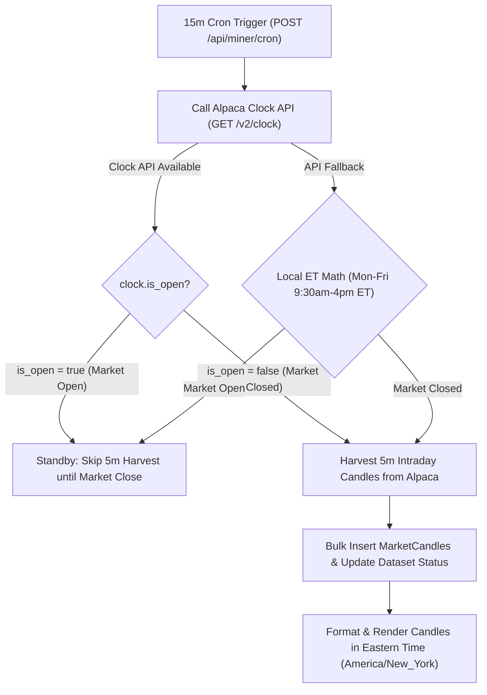

# Implementation Plan: Alpaca Clock API Integration & Eastern Time Standardization

## Goal Description
Integrate Alpaca's official **Clock API (`/v2/clock`)** to check market open/close status directly from Alpaca every 15 minutes, and standardize all chart timestamps, cron schedule badges, and intraday candles on **US Eastern Time (`America/New_York`)** (EST/EDT).

---

## Architecture & Workflow



---

## Detailed Component Changes

### 1. Alpaca Clock API Client (`lib/market-data.ts`)
Add `getAlpacaClock()` helper function:
```ts
export interface AlpacaClock {
  timestamp: string;
  is_open: boolean;
  next_open: string;
  next_close: string;
}

export async function getAlpacaClock(): Promise<AlpacaClock | null> {
  const apiKey = process.env.ALPACA_API_KEY;
  const secretKey = process.env.ALPACA_SECRET_KEY;
  if (!apiKey || !secretKey) return null;

  try {
    const url = `${process.env.ALPACA_BASE_URL || 'https://paper-api.alpaca.markets/v2'}/clock`;
    const res = await fetch(url, {
      headers: {
        'APCA-API-KEY-ID': apiKey,
        'APCA-API-SECRET-KEY': secretKey,
      },
      cache: 'no-store',
    });

    if (!res.ok) return null;
    return await res.json();
  } catch (e) {
    console.warn('[Alpaca Clock] API call failed, using ET fallback math:', e);
    return null;
  }
}
```

---

### 2. Timezone-Aware Harvester & Clock Validator (`lib/miner/harvester.ts`)
* Update `isOffMarketHours()`:
  - Queries `getAlpacaClock()`.
  - If clock returned: returns `!clock.is_open`.
  - Fallback: evaluates local time in `America/New_York` (Mon-Fri 9:30 AM – 4:00 PM ET = regular market hours standby).
* Update `getNextCronRunTime()`:
  - Calculates the next 15-minute slot or uses `clock.next_close` / `clock.next_open`.
  - Formats next run string in **US Eastern Time (`America/New_York`)** e.g. `6:00 PM EDT (Sat, Oct 10)`.

---

### 3. Eastern Time Candle Date Formatter (`lib/miner/aggregator.ts`)
Add `formatToET(dateInput)` utility:
```ts
export function formatToET(dateInput: string | Date | number): string {
  const d = new Date(dateInput);
  if (isNaN(d.getTime())) return String(dateInput);

  const formatter = new Intl.DateTimeFormat('en-US', {
    timeZone: 'America/New_York',
    year: 'numeric',
    month: '2-digit',
    day: '2-digit',
    hour: '2-digit',
    minute: '2-digit',
    hour12: false,
  });

  const parts = formatter.formatToParts(d);
  const map: Record<string, string> = {};
  for (const p of parts) map[p.type] = p.value;

  return `${map.year}-${map.month}-${map.day} ${map.hour}:${map.minute}`;
}
```

---

### 4. Dataset Candle API Route (`app/api/research/datasets/[id]/candles/route.ts`)
* Format all `MarketCandle.timestamp` values using `formatToET(timestamp)` before returning to client charts.

---

### 5. UI Updates (`app/page.tsx` & `components/StockChart.tsx`)
* **Phase 2 Header Badge**: Display next run formatted in Eastern Time (`⏰ Next Scheduled Run: 6:00 PM EDT (Sat, Oct 10)`).
* **Chart Tooltip & Timeframe Header**: Display `EDT` / `EST` label explicitly in chart headers and hover tooltips.

---

## Technical Files to Modify
1. [`lib/market-data.ts`](file:///Users/ajayovalekar/Repos/Gemini/LaughingStock/lib/market-data.ts)
2. [`lib/miner/harvester.ts`](file:///Users/ajayovalekar/Repos/Gemini/LaughingStock/lib/miner/harvester.ts)
3. [`lib/miner/aggregator.ts`](file:///Users/ajayovalekar/Repos/Gemini/LaughingStock/lib/miner/aggregator.ts)
4. [`app/api/research/datasets/[id]/candles/route.ts`](file:///Users/ajayovalekar/Repos/Gemini/LaughingStock/app/api/research/datasets/[id]/candles/route.ts)
5. [`app/page.tsx`](file:///Users/ajayovalekar/Repos/Gemini/LaughingStock/app/page.tsx)

---

## Verification Plan

### Automated Verification
1. **Build Verification**:
   ```bash
   npm run build
   ```

### Manual Verification
1. Trigger `/api/miner/cron` POST request:
   - Confirm Alpaca Clock API returns `is_open: false` during weekend/off-market.
   - Confirm response includes `nextCronRun` formatted in Eastern Time.
2. Click **"View Harvested Data"** on Phase 2 grid:
   - Confirm candles format timestamps in Eastern Time (`YYYY-MM-DD HH:mm EDT`).
