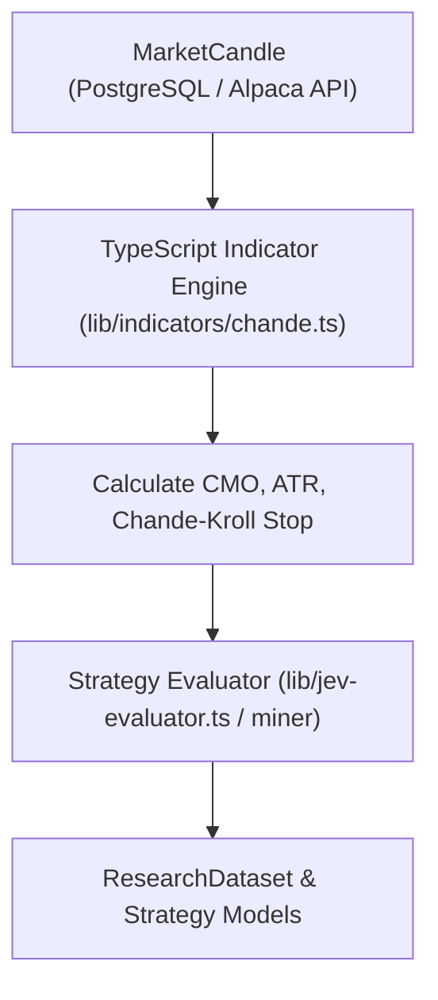

# Chande Trading Strategy Plan & Implementation Spec

## Executive Summary
This document specifies the implementation of **Tushar Chande’s Trading System**, integrating the **Chande Momentum Oscillator (CMO)**, **Chande-Kroll Trailing Stop**, and **Volatility-Adjusted Position Sizing**. This specification bridges the Python reference model (`plans/chande.txt`) into the **LaughingStock** TypeScript / Next.js / PostgreSQL trading engine.

---

## 1. Strategy Indicators & Mathematical Formulas

### A. Chande Momentum Oscillator (CMO)
The CMO measures momentum on unsmoothed price differences over a rolling period $N$.

$$\text{CMO}_N = 100 \times \frac{\sum \text{Up} - \sum \text{Down}}{\sum \text{Up} + \sum \text{Down}}$$

Where:
* $\Delta_t = \text{Close}_t - \text{Close}_{t-1}$
* $\text{Up}_t = \max(\Delta_t, 0)$
* $\text{Down}_t = \max(-\Delta_t, 0)$
* $\sum \text{Up} = \text{Rolling sum of } \text{Up}_t \text{ over } N \text{ periods}$
* $\sum \text{Down} = \text{Rolling sum of } \text{Down}_t \text{ over } N \text{ periods}$

> **Range**: $[-100, +100]$. Default Buy Threshold: $\text{CMO} > 0.0$ (or crossing above zero).

---

### B. Average True Range (ATR)
Measures market volatility across period $P$ (default 14).

$$\text{TR}_t = \max\left(\text{High}_t - \text{Low}_t, \, |\text{High}_t - \text{Close}_{t-1}|, \, |\text{Low}_t - \text{Close}_{t-1}|\right)$$
$$\text{ATR}_P = \frac{1}{P} \sum_{i=0}^{P-1} \text{TR}_{t-i}$$

---

### C. Chande-Kroll Trailing Stops
Calculates dynamic adaptive trailing stops based on peak prices and ATR volatility.

* **Preliminary Long Stop**:
  $$\text{LongStop}_{\text{prelim}} = \max(\text{High}_{t}, \dots, \text{High}_{t-p+1}) - (x \times \text{ATR}_p)$$
* **Final Long Trailing Stop**:
  $$\text{LongStop}_t = \max(\text{LongStop}_{\text{prelim}, t}, \dots, \text{LongStop}_{\text{prelim}, t-m+1})$$

* **Preliminary Short Stop**:
  $$\text{ShortStop}_{\text{prelim}} = \min(\text{Low}_{t}, \dots, \text{Low}_{t-p+1}) + (x \times \text{ATR}_p)$$
* **Final Short Trailing Stop**:
  $$\text{ShortStop}_t = \min(\text{ShortStop}_{\text{prelim}, t}, \dots, \text{ShortStop}_{\text{prelim}, t-m+1})$$

* **Default Parameters**: $p = 10$ (high/low window), $x = 2.0$ (ATR multiplier), $m = 14$ (smoothing window).

---

## 2. Timeframe & Period Resolution

"Periods" refer to the **number of candles** in the rolling window, not a fixed physical time unit.

| Timeframe / Bar Size | 14-Period Window Coverage | Use Case in LaughingStock |
| :--- | :--- | :--- |
| **1-Day (1D)** | 14 Trading Days (~3 calendar weeks) | Swing trading / Phase 1 conviction day identification |
| **1-Hour (1H)** | 14 Hours (~2 trading sessions) | Multi-day intraday trend identification |
| **15-Minute (15m)** | 210 Minutes (3.5 Hours) | Phase 2 intraday execution & stop tracking |
| **Full Session 15m** | 26 Periods (390 Minutes = 6.5 Hours) | Full 1-day intraday session momentum |

---

## 3. Risk Management & Volatility Position Sizing

Instead of fixed dollar allocations, order sizing is dynamically adjusted based on risk capital and volatility distance:

1. **Dollar Risk Limit**:
   $$\text{Dollar Risk} = \text{Capital} \times \text{Risk \% (default 2\%)}$$

2. **Stop Distance**:
   $$\text{Stop Distance} = \max\left(\text{Entry Price} - \text{LongStop}_t, \, 1.5 \times \text{ATR}_t\right)$$

3. **Shares Calculation**:
   $$\text{Shares} = \min\left(\left\lfloor \frac{\text{Dollar Risk}}{\text{Stop Distance}} \right\rfloor, \, \left\lfloor \frac{\text{Capital}}{\text{Entry Price} \times (1 + \text{Commission})} \right\rfloor\right)$$

---

## 4. Execution Rules & Friction Considerations

1. **Entry Rule**:
   * Triggered when $\text{CMO}_{t-1} < \text{BuyLevel} \le \text{CMO}_t$.
   * **Execution Realism**: To avoid same-bar lookahead bias, entry orders fill at $\text{Open}_{t+1}$ or $\text{Close}_t \times (1 + \text{Commission})$.

2. **Exit Rule**:
   * Triggered when $\text{Close}_t < \text{LongStop}_t$.
   * Exit filled at $\text{Close}_t \times (1 - \text{Commission})$.

3. **Slippage & Commission**:
   * Default commission = `0.1%` (`0.001`) per side.

---

## 5. Integration Plan into LaughingStock Engine

### Next Steps for Code Implementation:
1. Create `lib/indicators/chande.ts` in TypeScript providing `calculateCMO()`, `calculateATR()`, and `calculateChandeKrollStop()`.
2. Add `ChandeStrategy` evaluator to `lib/strategies.ts` / `lib/pipeline.ts`.
3. Integrate into Phase 1 / Phase 2 UI for visual overlay on intraday & daily charts.
