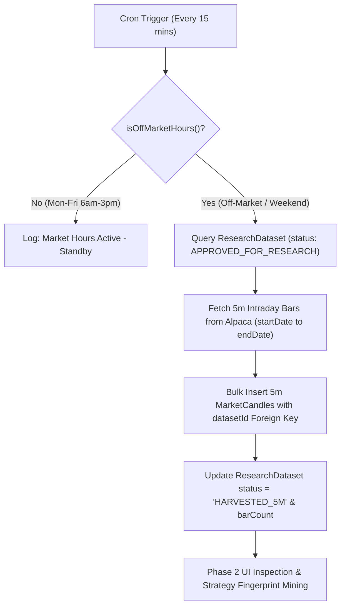

# Phase 2 Implementation Plan: Off-Market 5-Minute Intraday Harvester & Foreign Key Association

## Goal Description
Implement the **Phase 2 Off-Market Harvesting Engine**:
1. **Database Schema Relation**: Update PostgreSQL schema (`prisma/schema.prisma`) so `MarketCandle` has an explicit foreign key `datasetId` referencing `ResearchDataset(id)` (`onDelete: Cascade`).
2. **5-Minute (`5m`) Candle Harvester Engine**: Create an automated processing job (`app/api/miner/cron/route.ts` & `lib/miner/harvester.ts`) that scans `ResearchDataset` for queued datasets (`APPROVED_FOR_RESEARCH` / `PENDING_HARVEST`), downloads **5-minute intraday bars** across each dataset's date range (`startDate` to `endDate`), and bulk inserts them into `MarketCandle` linked to `datasetId`.
3. **Off-Market Hours Cron Schedule**:
   - Runs **every 15 minutes** strictly during off-market windows:
     * **Mon-Fri**: 3:00 PM – Midnight (15:00 to 23:59)
     * **Mon-Fri**: Midnight – 6:00 AM (00:00 to 05:59)
     * **Sat & Sun**: All Day (24 hours)
   - Evaluates `isOffMarketHours()` before processing. During regular market hours (6 AM – 3 PM), the harvester stands by to avoid interfering with live trading streams.
4. **Status Lifecycle & Auditability**: Upon successful 5m candle harvest, transition dataset status to `HARVESTED_5M` and update `barCount` with the count of 5m candles.
5. **Phase 2 UI Controls**: Provide a manual "Run Off-Market 5m Harvester Now" button in Phase 2 alongside the automated background cron schedule.

---

## User Review Required

> [!IMPORTANT]
> **Off-Market Cron Schedule Specifications**:
> * **Frequency**: Runs every 15 minutes (`*/15` mins).
> * **Active Windows**:
>   1. `Mon-Fri 15:00 - 23:59` (3:00 PM to Midnight)
>   2. `Mon-Fri 00:00 - 05:59` (Midnight to 6:00 AM)
>   3. `Sat & Sun 00:00 - 23:59` (All Day)
> * **Market Hours Inactive Window**: Mon-Fri 6:00 AM – 3:00 PM (safely skips processing).

---

## Technical Design & Architecture



---

## Proposed Changes

### Component 1: Database Schema (`prisma/schema.prisma`)

#### [MODIFY] `prisma/schema.prisma`
- Add `datasetId` foreign key and relation to `MarketCandle` and `ResearchDataset`:

```prisma
model MarketCandle {
  id        String           @id @default(cuid())
  datasetId String?
  dataset   ResearchDataset? @relation(fields: [datasetId], references: [id], onDelete: Cascade)
  symbol    String
  interval  String           @default("1d")
  timestamp DateTime
  open      Float
  high      Float
  low       Float
  close     Float
  volume    BigInt
  createdAt DateTime         @default(now())

  @@unique([symbol, interval, timestamp, datasetId])
  @@index([symbol, timestamp])
  @@index([datasetId])
}

model ResearchDataset {
  id             String         @id @default(cuid())
  datasetName    String         @unique
  symbol         String
  convictionDate String
  roiPct         Float
  startDate      String
  endDate        String
  barCount       Int
  paramX         Int            @default(15)
  paramY         Int            @default(3)
  paramZ         Int            @default(20)
  paramVmin      Float          @default(1.3)
  paramM         Float          @default(5.0)
  status         String         @default("APPROVED_FOR_RESEARCH")
  candles        Json
  marketCandles  MarketCandle[]
  createdAt      DateTime       @default(now())

  @@index([symbol])
}
```

---

### Component 2: Harvester Engine & Off-Market Cron API Route

#### [NEW] `lib/miner/harvester.ts`
- Functions:
  - `isOffMarketHours(date?: Date): boolean`: Returns `true` on Sat/Sun or M-F (15:00–24:00 & 00:00–06:00).
  - `processPhase2Harvesting(force: boolean = false)`:
    1. Checks `isOffMarketHours()`. If false and `force === false`, returns early with standby status.
    2. Queries `prisma.researchDataset.findMany({ where: { status: 'APPROVED_FOR_RESEARCH' } })`.
    3. For each dataset:
       - Downloads `5m` interval candles from Alpaca for `startDate` to `endDate`.
       - Maps candles into `MarketCandle` records with `datasetId: dataset.id` and `interval: '5m'`.
       - Calls `prisma.marketCandle.createMany({ data: records, skipDuplicates: true })`.
       - Updates dataset status to `'HARVESTED_5M'` and sets `barCount: records.length`.
    4. Returns execution summary JSON.

#### [NEW] `app/api/miner/cron/route.ts`
- Exposes `GET` and `POST` endpoints to trigger `processPhase2Harvesting()`.
- Accepts `force=true` (for manual UI triggers) or runs automated scheduled sweeps.

---

### Component 3: Phase 2 UI Integration (`app/page.tsx`)

#### [MODIFY] `app/page.tsx`
- **Harvester Controls**: Add "⚡ Run 5m Harvester Now" button to Phase 2 (Miner tab) header.
- **Off-Market Schedule Badge**: Display `"🌙 Off-Market Cron Active: 3pm-Midnight, Midnight-6am M-F, Sat & Sun All Day (Every 15m)"`.
- **Table Columns & Badges**:
  - Render dataset status badges: `🟢 HARVESTED_5M` vs `⏳ PENDING_5M_HARVEST`.
  - Display `datasetId` indicator and foreign-key linked 5m bar count.
  - Provide a one-click button to view/inspect foreign-key linked 5m `MarketCandles` from PostgreSQL.

---

## Verification Plan

### Automated Verification
1. **Prisma Generation & Migration**:
   ```bash
   npx prisma generate
   npx prisma db push
   ```
2. **Build Verification**:
   ```bash
   npm run build
   ```

### Manual Verification Flow
1. **Save Dataset in Phase 1**:
   - Search a symbol (e.g. `NVDA`), select a range, and click a conviction day.
   - Confirm dataset is saved with status `APPROVED_FOR_RESEARCH`.
2. **Run Phase 2 Harvester**:
   - Navigate to Phase 2 (Miner tab).
   - Click "Run 5m Harvester Now" (or trigger `/api/miner/cron?force=true`).
   - Confirm 5-minute bars are downloaded from Alpaca and stored in `MarketCandle` with `datasetId` populated.
3. **Database Verification**:
   - Query PostgreSQL `MarketCandle` to verify `datasetId` matches `ResearchDataset.id` and `interval = '5m'`.
